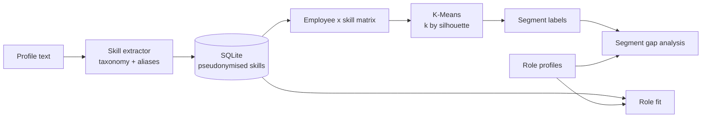

# Workforce Skill Intelligence

[](https://github.com/Shivanshi-svg/workforce-skill-intelligence/actions)

An AI layer that turns free-text employee profiles into **structured skills**, **segments the
workforce by skill profile**, and reports **role fit and skill gaps**, exposed through a REST API.

> **Data note:** this repository uses only synthetic profiles. The pipeline design reflects the
> kind of workforce-segmentation problem described on my CV, built here from scratch on public,
> synthetic data with no employer code or data.

## What it does

1. **Skill extraction**: maps free text ("PySpark on Databricks", "CI/CD", "C# services") to a
   canonical taxonomy with alias handling and token-aware boundaries, so `java` does not match
   inside `javascript`.
2. **Segmentation**: builds a binary employee x skill matrix and clusters it with K-Means. The
   number of segments is chosen by silhouette score unless you fix `k`. Segments are labelled by the
   skills that are over-represented inside them compared with the whole workforce.
3. **Role fit and gap analysis**: coverage against target role profiles (`data/roles.json`), best-fit
   roles per employee, and, per segment, the share of members missing each required skill.
4. **Privacy by design**: employee references are pseudonymised with a salted HMAC before they are
   stored, and the API never returns the original reference.

## Architecture



## Quick start

```bash
python -m venv .venv && source .venv/bin/activate
pip install -r requirements-dev.txt
pytest -q
python -m skillintel.cli --employees 60 --k 5    # segment a synthetic workforce
uvicorn skillintel.api:app --reload              # http://localhost:8000/docs
```

Docker:

```bash
docker build -t skillintel . && docker run -p 8000:8000 -e SKILLINTEL_SALT=$(openssl rand -hex 16) skillintel
```

## API

| Method | Path | Purpose |
|---|---|---|
| POST | `/profiles` | `{employee_ref, text}` -> pseudonymised id + extracted skills |
| GET | `/employees/{id}/fit?role=` | Gap report for a role, or top-3 best-fit roles |
| POST | `/segments` | Cluster all stored profiles (`{"k": 5}` optional) |
| GET | `/segments/gaps?role=` | Per-segment share of members missing each required skill |
| GET | `/roles` | Available role profiles |

## Example output (synthetic data, k = 5)

```
Segment: excel / power bi / statistics          (analytics)
Segment: stakeholder / people / project mgmt    (management)
Segment: azure / data engineering / python      (data)
Segment: react / rest apis / javascript         (web)
Segment: nlp / rag / langchain                  (AI)
```

Run `python -m skillintel.cli` to reproduce; exact sizes vary with the seed.

## Limitations (and what I would do next)

- Extraction is rule-based, so skills phrased in unlisted ways are missed. Next step: embedding
  similarity against taxonomy entries, or an LLM extractor validated against this rule-based baseline.
- Synthetic profiles are cleanly separated, so segment quality here is optimistic. Real HR text is
  noisier, and `choose_k` may then prefer more, smaller segments.
- The taxonomy is a small CSV. It can be replaced by an export from ESCO or O*NET, which share the
  same skill/alias shape; no ESCO data is bundled.
- SQLite and a single process are fine for a demo. Use Postgres and authentication for real HR data,
  and consult your DPO: employee skill data is personal data under GDPR.

## Layout

```
skillintel/   taxonomy, extraction, segmentation, gaps, privacy, store, api, cli
data/         skills.csv, roles.json
tests/        pytest suite (extraction, segmentation, gaps, privacy/store, API)
```
